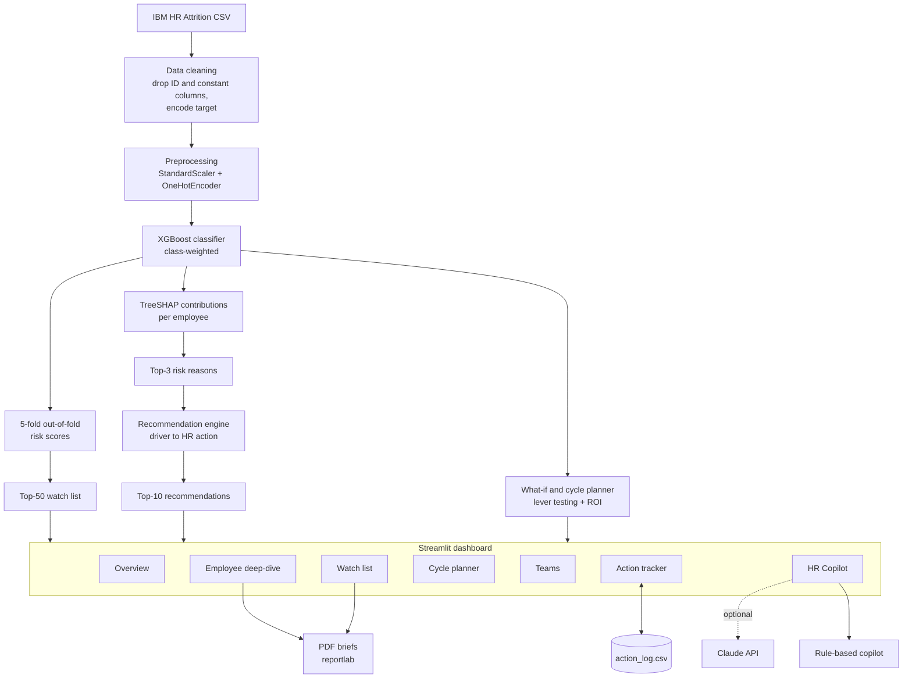

# 🛡️ TalentGuard — Employee Attrition Early-Warning System

> Predict who is likely to resign next cycle, explain **why**, and tell HR **what to do about it** — while there is still time to act.

Built for the **TechNova Solutions** HR / People Analytics challenge (Project 1).

---

## Table of Contents
1. [Problem Statement](#1-problem-statement)
2. [Solution Overview](#2-solution-overview)
3. [Architecture Diagram](#3-architecture-diagram)
4. [Technology Stack](#4-technology-stack)
5. [Setup and Installation Instructions](#5-setup-and-installation-instructions)
6. [Business Benefits](#6-business-benefits)
7. [Future Enhancements](#7-future-enhancements)
8. [Project Structure](#8-project-structure)
9. [Responsible Use and Limitations](#9-responsible-use-and-limitations)

---

## 1. Problem Statement

**Client:** TechNova Solutions, a 12,000-person IT services firm losing **16% of its staff every year**. Every exit costs **6–9 months of salary** in hiring, onboarding and lost productivity.

**The ask:** *"Tell me who is likely to resign next cycle, why, and what to do — while there's time to act."*

**Constraints and requirements**

| Requirement | Detail |
|---|---|
| Capacity | HR can run retention conversations with only **50 employees per cycle** |
| Output 1 | A ranked **Top-50 watch list** with each employee's **top-3 risk reasons** |
| Output 2 | A concrete **retention recommendation for the top 10** |
| Extra requirement | HR must be able to **ask for recommendations / next steps** for a given employee or situation |
| Data | IBM HR Analytics Employee Attrition dataset: 1,470 employees, 35 columns, target `Attrition` (Yes/No) |

**Traps handled deliberately**
- **ID and constant columns** (`EmployeeNumber`, `EmployeeCount`, `Over18`, `StandardHours`) carry no signal and can hurt the model. They are removed before training, and the ID is kept only to label results.
- **Class imbalance:** only about 1 in 6 employees leaves, so *accuracy is misleading* (predicting "nobody leaves" scores ~84%). We use **PR-AUC, Precision@50 and Recall@50** and train with class weighting.
- **In-sample scoring:** scoring the same rows the model trained on inflates risk. All watch-list scores are **out-of-fold** predictions.

---

## 2. Solution Overview

TalentGuard is an end-to-end pipeline plus an interactive Streamlit dashboard.

**Pipeline**
1. **Clean:** drop ID and constant columns; encode the target; optionally exclude protected attributes (Age, Gender, Marital Status).
2. **Model:** XGBoost classifier inside a scikit-learn pipeline (standard scaling for numeric features, one-hot encoding for categorical ones, `scale_pos_weight` for imbalance).
3. **Honest scoring:** 5-fold stratified cross-validation produces an out-of-fold risk score for every employee.
4. **Explain:** TreeSHAP contributions (from XGBoost) are merged back to the original columns, giving each employee's top risk factors in plain words, e.g. `OverTime = Yes`.
5. **Recommend:** each risk driver maps to an HR action (workload, pay, growth, flexibility, manager), so recommendations are tied to that employee's own drivers.
6. **Act:** planner, team view, PDF briefs and an action tracker turn scores into decisions.

**Dashboard features**

| Tab | What it does |
|---|---|
| **Overview** | KPIs, model metrics, risk by department and role, cost exposure of the top 50 |
| **Watch list** | Top-50 with top-3 reasons, top-10 recommendations, CSV downloads, PDF briefs for the top 10 |
| **Employee deep-dive** | Risk drivers chart, recommended actions, cost of exit, **what-if simulator**, PDF brief |
| **Cycle planner** | Picks the best action per employee and fills the cycle by ROI within a talk count and budget |
| **Teams** | Hot-spot tables, heat map, and team-level actions by department, role or manager tenure |
| **Action tracker** | Logs actions, owners, status and outcomes; compares who stayed vs the model's expectation |
| **Ask HR Copilot** | HR asks "what should I do for employee 622?" — rule-based, or free-text AI answers with Claude |

**Deliverable files** (also downloadable from the dashboard): `top50_watchlist.csv`, `top10_recommendations.csv`.

---

## 3. Architecture Diagram



**Plain-text version**

```
 CSV -> clean -> preprocess -> XGBoost -> out-of-fold risk ---------> Top-50 watch list --+
                                  |                                                         |
                                  +-> TreeSHAP -> top-3 reasons -> recommendation engine --+--> Streamlit dashboard
                                  |                                                         |   (7 tabs)
                                  +-> what-if / cycle planner (ROI) ------------------------+     |
                                                                                                   +-> PDF briefs
                                                                                                   +-> Action log (CSV)
                                                                                                   +-> HR Copilot (rules / Claude)
```

---

## 4. Technology Stack

| Layer | Technology |
|---|---|
| Language | Python 3.10+ |
| Data | pandas, NumPy |
| Machine learning | scikit-learn (pipeline, preprocessing, cross-validation, metrics), XGBoost |
| Explainability | TreeSHAP via XGBoost `pred_contribs` |
| Dashboard | Streamlit |
| Visualisation | Matplotlib, Streamlit charts and styled tables |
| Reporting | ReportLab (PDF briefs) |
| AI assistant (optional) | Anthropic Claude API (`anthropic` SDK) |
| Storage | CSV (action log), Streamlit session state |
| Deployment | Streamlit Community Cloud (free), or any host that runs Python |

---

## 5. Setup and Installation Instructions

### Prerequisites
- Python **3.10 – 3.12**
- `pip`, and Git (only needed for deployment)

### Run locally

**1. Get the project** — unzip it, or clone your repository, and open a terminal in the project folder.

**2. Create and activate a virtual environment**

Windows:
```bash
python -m venv venv
venv\Scripts\activate
```
macOS / Linux:
```bash
python3 -m venv venv
source venv/bin/activate
```

**3. Install dependencies**
```bash
pip install -r requirements.txt
```

**4. Start the dashboard**
```bash
streamlit run dashboard.py
```
Open **http://localhost:8501**. The first load trains the model (about 20 seconds) and is then cached.

If `streamlit` is not recognised, use `python -m streamlit run dashboard.py`. If port 8501 is busy, add `--server.port 8502`.

> **Never name any file `streamlit.py`**; it shadows the real Streamlit package and breaks the app.

### Optional: enable the Claude-powered copilot
Create `.streamlit/secrets.toml` (see `.streamlit/secrets.toml.example`):
```toml
ANTHROPIC_API_KEY = "your-key-here"
# ANTHROPIC_MODEL = "claude-sonnet-5-5"
```
Restart the app; the sidebar shows **Claude copilot: connected**. Without a key the copilot runs in rule-based mode. **Never commit `secrets.toml` to GitHub.**

### Use your own data
Upload a CSV with the same columns from the sidebar. If it contains a `ManagerID` column, a manager-level view appears in the **Teams** tab automatically.

### Deploy to Streamlit Community Cloud (free)
1. Push the project to a GitHub repository (include `data/` and `requirements.txt`; the `.gitignore` already excludes secrets and the local action log).
2. Go to [share.streamlit.io](https://share.streamlit.io) → **New app** → select the repo and branch → main file **`dashboard.py`** → **Deploy**.
3. For the AI copilot, open **App settings → Secrets** and paste `ANTHROPIC_API_KEY = "..."`.
4. Note that the action log resets when the cloud app restarts; use the **Backup log** button, or connect a Google Sheet or database for permanent storage.

### Reproduce the deliverable CSVs
Download `top50_watchlist.csv` and `top10_recommendations.csv` from the **Watch list** tab.

---

## 6. Business Benefits

- **Focus scarce HR time:** with only 50 conversations per cycle, the model prioritises the employees where a conversation matters most. The dashboard reports **Precision@50**, so you can see how many flagged people actually left.
- **Lower attrition cost:** each avoided exit saves 6–9 months of salary. The dashboard shows the cost exposure of the watch list, and the planner estimates the value of exits avoided against the cost of actions.
- **Actionable, not just predictive:** every flagged employee comes with plain-language reasons and specific actions (workload, pay, growth, flexibility, manager), plus a one-page PDF brief for the manager.
- **Smarter budgets:** the cycle planner compares actions by return on spend instead of treating every case alike.
- **Systemic insight:** the team view shows where problems are concentrated (a department, a role, a new-manager cohort) so HR can fix causes, not only individual cases.
- **Learning loop:** the action tracker records what was done and whether people stayed, so the retention programme can be measured and improved.
- **Self-serve for HR:** HR can ask the copilot questions in plain language without needing a data analyst.
- **Trustworthy results:** out-of-fold scoring and imbalance-aware metrics avoid over-optimistic numbers.

---

## 7. Future Enhancements

- **Calibrated probabilities and threshold tuning** so "70% risk" means roughly 70%, with the cut-off tuned to HR's 50-person capacity.
- **Temporal modelling:** use historical snapshots to predict resignations over a defined future window (for example the next 90 days) and track risk trends per employee.
- **Richer signals:** engagement surveys, performance reviews, internal mobility, badge or attendance data and exit-interview text.
- **Uplift / causal modelling** to estimate which action truly changes behaviour for which employee, instead of relying on correlational what-if estimates.
- **Fairness auditing:** monitor risk and recommendation rates across gender, age and marital status groups; add bias reports.
- **Permanent storage and authentication:** move the action log to a database or Google Sheet and add role-based login so managers see only their own teams.
- **HRIS and notification integration:** connect to Workday, SAP SuccessFactors or BambooHR; send Slack or email nudges to managers.
- **Real manager hierarchy** (`ManagerID`) for true manager-level analytics.
- **Model monitoring and automated retraining** with drift alerts and an experiment log (for example MLflow).
- **Containerised deployment** (Docker) and a REST API (FastAPI) so other systems can request risk scores.
- **Executive summary export:** one-click slide or report summarising the cycle's findings.
- **Multilingual and voice-enabled copilot** for global HR teams.

---

## 8. Project Structure

```
talentguard/
├── dashboard.py          # Streamlit UI (7 tabs)
├── core.py               # model, out-of-fold scoring, drivers, recommendations, planner, team stats
├── llm.py                # optional Claude API wrapper
├── reports.py            # PDF retention briefs (ReportLab)
├── tracker.py            # retention action log
├── requirements.txt
├── README.md
├── .gitignore
├── .streamlit/
│   └── secrets.toml.example
└── data/
    └── WA_Fn-UseC_-HR-Employee-Attrition.csv
```

---

## 9. Responsible Use and Limitations

- **Decision support, not a verdict.** Scores are statistical estimates from past patterns. Use them to prioritise supportive conversations, **never for adverse decisions** such as demotion, denial of promotion or dismissal.
- **Correlation is not causation.** The what-if simulator and planner show how the model's risk changes, not guaranteed outcomes. Validate with the action tracker.
- **Protected attributes.** Age, Gender and Marital Status can be excluded from the model with one sidebar checkbox and are never used to drive recommendations.
- **Privacy.** HR data is sensitive. Restrict access, and be aware that AI mode sends employee IDs, roles, risk scores and reasons to the Claude API.
- **Dataset.** The IBM HR Analytics dataset is a fictional, small sample (1,470 rows); results on real company data will differ and should be re-validated.
